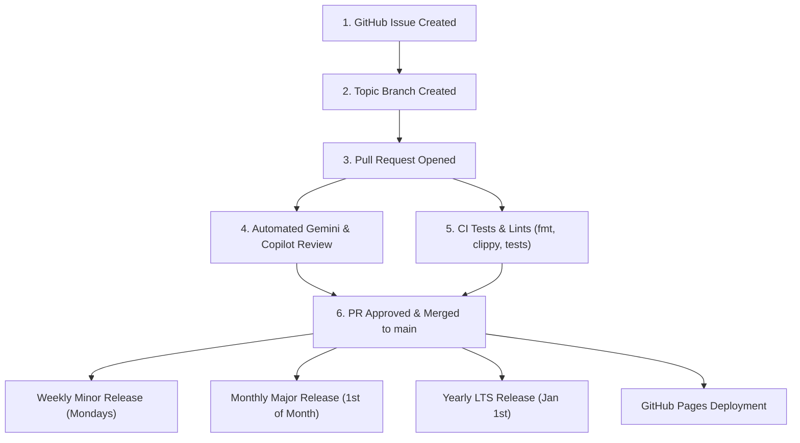

# TaskMaster - High-Performance Cross-Platform Todo App (Rust)

A fast, memory-safe, modern Todo and Task Management application built in **Rust 2021** with **Axum**, **Ratatui**, and **persistent atomic JSON storage**. Designed to run seamlessly as an **interactive TUI in your terminal**, a **CLI tool**, a **high-performance local/cloud server**, and an **installable Progressive Web App (PWA)** across **Android**, **iPhone**, **iPad**, **Windows**, **macOS**, and **Linux**.

---

## ✨ Features

- 🦀 **Pure Rust Core**:
  - Memory-safe, lightning-fast async backend powered by **Axum** and **Tokio**.
  - All web, styles, scripts, and PWA assets are embedded directly into the compiled binary via `rust-embed`—single self-contained executable with zero runtime dependencies.
- 📺 **Interactive Terminal UI (TUI)**:
  - Rich dashboard powered by **Ratatui** and **Crossterm**.
  - Live progress gauge, priority badges, detail pane, instant search (`/`), filter tabs (`Tab`), and keyboard shortcuts (`Space` to toggle, `a` to add, `d` to delete).
- 💻 **CLI Management**:
  - Direct terminal subcommands (`todo list`, `todo add`, `todo done`, `todo rm`, `todo clear`, `todo stats`).
- 🌐 **Cross-Platform & LAN Ready**:
  - Binds to `0.0.0.0` automatically, printing both local PC and LAN mobile addresses.
  - Automatically renders a scannable **ASCII QR code** right in your terminal for instant camera pairing from mobile phones and tablets.
- 📱 **Progressive Web App (PWA)**:
  - Installable as a standalone native app window on **Android**, **iOS (iPhone/iPad)**, **Windows**, **macOS**, and **Linux**.
  - Full-screen support, app icons, offline Service Worker caching, and light/dark theme persistence.
- 💾 **Safe Atomic Storage**:
  - Human-inspectable JSON storage (`todos.json`).
  - Thread-safe (`RwLock`) and crash-resilient atomic writes (write-to-temp + atomic rename + sync) to prevent data loss.
- 🚀 **Production CI/CD & Automation**:
  - **Weekly Minor Release**: Automated weekly minor version releases (`0 0 * * 1`).
  - **Monthly Major Release**: Automated monthly major version releases (`0 0 1 * *`).
  - **Yearly LTS Release**: Automated yearly Long-Term Support release and branch creation (`0 0 1 1 *`).
  - **Dependency Update Bot**: Weekly automated dependency updates and verification PRs.
  - **Gemini AI PR Reviewer**: Automated pull request reviews and security analysis powered by Google Gemini API.
  - **GitHub Pages**: Automated deployment of the interactive live web app demo and API docs.

---

## 🚀 Quick Start

### 1. Prerequisites
Ensure you have the Rust toolchain installed (Rust 1.80+):
```bash
curl --proto '=https' --tlsv1.2 -sSf https://sh.rustup.rs | sh
```

### 2. Run the Web & PWA Server
To launch the server on `0.0.0.0:8000` (default):
```bash
cargo run --release
# or explicitly:
cargo run --release -- serve --host 0.0.0.0 --port 8000
```

When started, your terminal displays:
- **Local PC Access**: `http://localhost:8000`
- **Mobile / LAN Access**: `http://<your-local-ip>:8000`
- **ASCII QR Code**: Scan with your Android, iPhone, or iPad camera to launch immediately!

---

## 📺 Using the Interactive TUI

Launch the interactive Terminal User Interface:
```bash
cargo run --release -- tui
```

### ⌨️ TUI Keyboard Shortcuts

| Key | Action |
|---|---|
| `↑` / `k`, `↓` / `j` | Navigate tasks up and down |
| `Space` or `Enter` | Toggle task completion status |
| `a` | Add new task (opens modal; press `Tab` to cycle priority) |
| `d` or `x` | Delete selected task |
| `Tab` / `Right` | Cycle through filters (**All** ➔ **Active** ➔ **Completed**) |
| `1`, `2`, `3` | Jump directly to filter (**1**: All, **2**: Active, **3**: Done) |
| `/` | Enter search filter mode |
| `c` | Clear all completed tasks (press `y` to confirm) |
| `r` | Refresh/reload tasks from storage |
| `q` or `Esc` | Quit TUI / Close modal |

---

## 💻 CLI Commands

Manage tasks directly from shell scripts or command line:

```bash
# Add tasks with optional description and priority (low, medium, high)
cargo run -- add "Implement Rust tests" --desc "Write storage & API integration tests" --priority high
cargo run -- add "Buy milk" --priority low

# List tasks with filters
cargo run -- list
cargo run -- list --status active
cargo run -- list --priority high
cargo run -- list --search "milk"

# Toggle completion status of task #1
cargo run -- done 1

# View statistics
cargo run -- stats

# Delete task #2
cargo run -- rm 2

# Clear all completed tasks
cargo run -- clear

# View all CLI options
cargo run -- --help
```

---

## 📱 Cross-Platform Installation

### 📱 Android
1. Scan the terminal ASCII QR code or visit `http://<your-lan-ip>:8000` in **Chrome**.
2. Tap **"Install"** in the app header (or Chrome menu `⋮` ➔ **"Install app"**).
3. The app installs to your home screen and drawer, opening as a full-screen native mobile application.

### 📱 iPhone / iPad (iOS)
1. Open `http://<your-lan-ip>:8000` in **Safari**.
2. Tap the **Share** button (square with arrow pointing up).
3. Select **"Add to Home Screen"** and tap **"Add"**.
4. TaskMaster will launch in standalone native app window mode with full touch support.

### 💻 Linux, Windows & macOS Desktop
1. Open `http://localhost:8000` in Chrome, Edge, or Brave.
2. Click the **Install** button in the top navigation bar or address bar.
3. TaskMaster will install as an independent desktop application pinned to your taskbar/dock and app menu.
4. On Linux, a desktop launcher file is provided at `deploy/todo.desktop`.

---

## 🐳 Docker & Container Deployment

### 1. Run with Docker Compose (Recommended)
Launch the container with persistent storage volume:
```bash
docker compose up -d
```
Stop the container:
```bash
docker compose down
```

### 2. Build & Run with Docker CLI
```bash
# Build the optimized multi-stage image
docker build -t taskmaster-todo:latest .

# Run container with volume mounted for data persistence
docker run -d \
  --name taskmaster-app \
  -p 8000:8000 \
  -v $(pwd)/data:/data \
  -e TODO_STORAGE_PATH=/data/todos.json \
  --restart unless-stopped \
  taskmaster-todo:latest
```

---

## ☁️ Deploying to Cloud Service Providers

Configuration templates are available in the [`deploy/`](deploy/) folder:

### 1. Fly.io
Deploy to Fly.io with a persistent volume:
```bash
# Authenticate and launch
fly launch --config deploy/fly.toml --no-deploy
# Create persistent volume for todos.json
fly volumes create todo_data --size 1 --region iad
# Deploy
fly deploy --config deploy/fly.toml
```

### 2. Render
1. Create a new **Web Service** on [Render](https://render.com).
2. Connect your repository.
3. Select **Docker** environment or use `deploy/render.yaml`.
4. Attach a persistent disk mounted to `/data`.

### 3. Railway / Heroku / Generic PaaS
Deploy using the provided `deploy/Procfile`:
```
web: todo serve --host 0.0.0.0 --port ${PORT:-8000}
```

### 4. Linux VPS (Systemd Service)
Deploy directly on Ubuntu/Debian/Arch Linux bare metal or VPS:
```bash
# 1. Build release binary and install to /usr/local/bin
cargo build --release
sudo cp target/release/todo /usr/local/bin/

# 2. Create data directory
sudo mkdir -p /var/lib/taskmaster
sudo chown -R www-data:www-data /var/lib/taskmaster

# 3. Install and enable systemd service
sudo cp deploy/todo.service /etc/systemd/system/
sudo systemctl daemon-reload
sudo systemctl enable --now todo

# 4. Check status
sudo systemctl status todo
```

---

## 📡 REST API Reference

| Method | Endpoint | Description |
|---|---|---|
| `GET` | `/api/health` | Health check endpoint (`{"status": "ok"}`) |
| `GET` | `/api/todos` | List todos (query: `status`, `search`, `priority`) |
| `POST` | `/api/todos` | Create a new task (body: `TodoCreate`) |
| `GET` | `/api/todos/{id}` | Get task by ID |
| `PUT` | `/api/todos/{id}` | Update title, description, priority, or status |
| `PATCH` | `/api/todos/{id}/toggle` | Toggle task completion status |
| `DELETE` | `/api/todos/{id}` | Delete task by ID |
| `DELETE` | `/api/todos-completed/clear` | Clear all completed tasks |
| `GET` | `/api/stats` | Retrieve task statistics & completion percentage |

---

## 🔄 Release Cycles & Automation

TaskMaster follows an automated release schedule:



- **Weekly Minor Release** (`.github/workflows/release-minor-weekly.yml`): Runs Mondays at 00:00 UTC, bumps minor version (`X.Y+1.0`), creates git tag `vX.Y.0`, and attaches compiled binaries for Linux, macOS, and Windows.
- **Monthly Major Release** (`.github/workflows/release-major-monthly.yml`): Runs on the 1st of every month, bumps major version (`X+1.0.0`), and publishes release notes.
- **Yearly LTS Release** (`.github/workflows/release-lts-yearly.yml`): Runs January 1st, creates dedicated `lts-YYYY` branch and tag `vX.0.0-lts-YYYY`.
- **Automated Dependency Updates** (`.github/workflows/dependency-update.yml` & `.github/dependabot.yml`): Weekly automated crate updates, full test verification, and automated PR generation.
- **GitHub Pages** (`.github/workflows/deploy-pages.yml`): Automatically publishes the interactive web client demo and rustdoc API documentation to GitHub Pages.
- **Gemini AI PR Reviewer** (`.github/workflows/gemini-pr-review.yml`): Powered by `GEMINI_API_KEY`, automatically provides deep code reviews for every PR.

---

## 🤝 Contribution Workflow

To maintain code quality, all contributions follow this process:

1. **Create an Issue**: Open a [Bug Report](.github/ISSUE_TEMPLATE/bug_report.yml) or [Feature Request](.github/ISSUE_TEMPLATE/feature_request.yml).
2. **Create a Topic Branch**: Branch off `main` (e.g. `feat/your-feature-name` or `fix/your-bug`).
3. **Run Local Checks**:
   ```bash
   cargo fmt -- --check
   cargo clippy --all-targets --all-features -- -D warnings
   cargo test --all-targets --all-features
   ```
4. **Open a Pull Request**: Reference your issue in the description (`Fixes #<issue-number>`).
5. **AI Review & CI**: Gemini PR Reviewer and CI checks will analyze your code.
6. **Merge**: Once approved and checks pass, the PR is merged into `main`.

---

## 📜 License

Licensed under either of:
- Apache License, Version 2.0 ([LICENSE-APACHE](LICENSE-APACHE) or http://www.apache.org/licenses/LICENSE-2.0)
- MIT license ([LICENSE-MIT](LICENSE-MIT) or http://opensource.org/licenses/MIT)
at your option.
