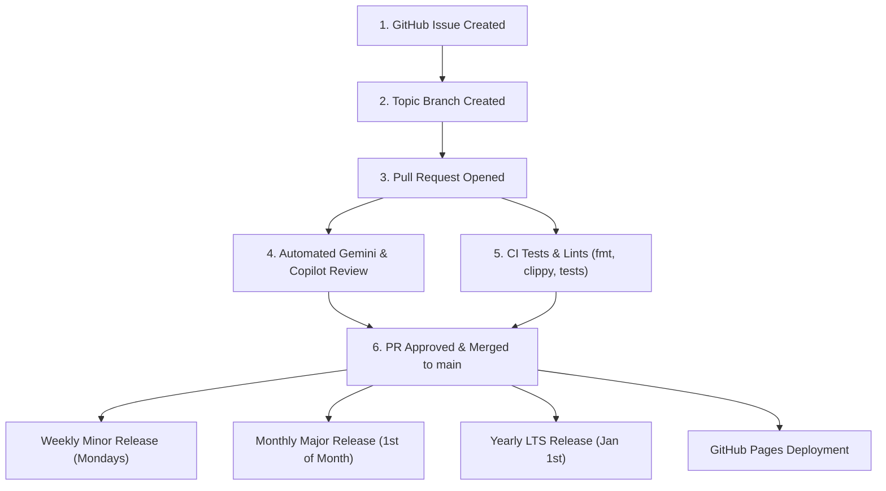

# Release Cadence & Automation Architecture

TaskMaster follows an automated release schedule and strict issue-first trunk-based development workflow.

---

## 🔄 Release Pipeline

---

## 📅 Automated Release Schedule

### 1. Weekly Minor Release (`release-minor-weekly.yml`)
- **Trigger**: Every Monday at `00:00 UTC` (cron `0 0 * * 1`) or manual dispatch.
- **Action**: Bumps the minor version (`0.Y.0` ➔ `0.Y+1.0`), creates git tag `vX.Y.0`, and triggers binary builds across Linux, Windows, and macOS.

### 2. Monthly Major Release (`release-major-monthly.yml`)
- **Trigger**: 1st of every month at `00:00 UTC` (cron `0 0 1 * *`) or manual dispatch.
- **Action**: Bumps major version (`X.0.0` ➔ `X+1.0.0`), generates release notes, and publishes GitHub releases.

### 3. Yearly LTS Release (`release-lts-yearly.yml`)
- **Trigger**: Every January 1st at `00:00 UTC` (cron `0 0 1 1 *`) or manual dispatch.
- **Action**: Creates a dedicated Long-Term Support maintenance branch (e.g. `lts-2026`) and tag `vX.0.0-lts-2026`.

---

## 🤖 CI/CD Workflows & Bots

| Workflow | Path | Purpose |
|---|---|---|
| **CI Matrix** | `.github/workflows/ci.yml` | Validates `cargo fmt`, `clippy -D warnings`, `cargo test`, and security audit on Ubuntu, Windows, and macOS. |
| **Gemini AI PR Reviewer** | `.github/workflows/gemini-pr-review.yml` | Analyzes pull request diffs using Google Gemini AI (`gemini-3.8-flash`) and posts automated code reviews. |
| **Deploy GitHub Pages** | `.github/workflows/deploy-pages.yml` | Builds and deploys the live web client demo and rustdoc documentation on pushes to `main`. |
| **Dependency Update Bot** | `.github/workflows/dependency-update.yml` | Weekly automated `cargo update` with test verification and automated PR creation. |
| **Dependabot Automerge** | `.github/workflows/dependabot-automerge.yml` | Automatically approves and enables auto-merge for non-breaking Dependabot PRs. |
| **PR Issue Linker** | `.github/workflows/pr-issue-linker.yml` | Ensures every opened PR explicitly references an open GitHub issue. |
